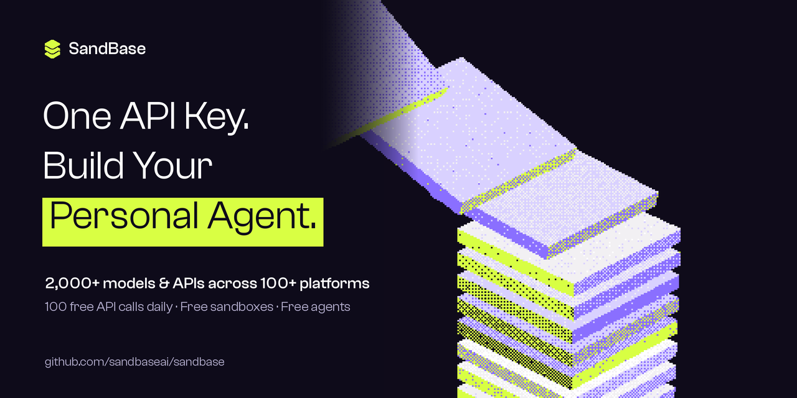

<p align="center">
  <a href="https://www.sandbase.ai"></a>
</p>

<p align="center">
  <b>AI models, data APIs, sandboxes and agents. One key. Pay as you go.</b>
</p>

<p align="center">
  <!-- counts:en --><b>2,000+ models &amp; APIs</b> · 400+ AI models · 1,700+ data APIs from 100+ platforms<br><b>100 free API calls / day</b> · <b>Free sandboxes</b> · <b>Free agents</b><!-- /counts:en -->
</p>

<p align="center">
  <a href="https://github.com/sandbaseai/sandbase/actions/workflows/ci.yml"></a>
  <a href="https://github.com/sandbaseai/sandbase/actions/workflows/refresh.yml"></a>
  <a href="LICENSE"></a>
  <a href="https://github.com/sandbaseai/sandbase/stargazers"></a>
</p>

<p align="center">
  <a href="https://www.sandbase.ai/console"><b>Get an API key</b></a> ·
  <a href="docs/INDEX.md">All models &amp; APIs</a> ·
  <a href="docs/platforms/README.md">By platform</a> ·
  <a href="https://www.sandbase.ai/docs/">Docs</a> ·
  <a href="README.zh-CN.md">中文</a>
</p>

---

## Why SandBase

Most platforms cover one layer: an LLM gateway, a media API, a sandbox, or a tool catalog. SandBase covers all four with **one key, one balance and one bill**, and the layers work together. Agents call any model or API in the catalog, and their code runs in SandBase sandboxes.

| | What you get | Price | Works with |
|---|---|---|---|
| 🧠 **Models** | LLM, image, video, audio, embedding | Pay per call or per token | OpenAI, Anthropic and Gemini SDKs |
| 🔌 **Data APIs** | Social, search, SEO, e-commerce, finance and more | **100 free calls / day**, then pay per call | One `POST /v1/run` for every API |
| 📦 **Sandboxes** | Isolated machines for code, commands and files | **Free** | The official E2B SDK |
| 🤖 **Agents** | Agents, Sessions, HTTP Services, Schedules, Skills | **Free** (you pay for the models and APIs they call) | The official OpenAI Agents API |

## Quickstart

Get a key at [sandbase.ai/console](https://www.sandbase.ai/console), then:

```bash
export SANDBASE_API_KEY=sk-...

curl https://api.sandbase.ai/v1/run \
  -H "Authorization: Bearer $SANDBASE_API_KEY" -H "Content-Type: application/json" \
  -d '{"model": "exa/search", "query": "AI agents", "numResults": 3}'
```

Every model and API takes the same request: `model` plus its fields. `run()` in the clients returns the finished result whether the call is sync or async.

```python
# pip install "git+https://github.com/sandbaseai/sandbase#subdirectory=sdk/python"
from sandbase import SandBase

sb = SandBase()
sb.run("exa/search", query="AI agents", numResults=3)
sb.run("bytedance/seedance/2.5/text-to-video", prompt="a cat surfing", duration=4)  # async video, waits
```

<details>
<summary><b>TypeScript</b></summary>

```ts
import { SandBase } from "@sandbaseai/sdk"; // sdk/typescript: one file, no dependencies

const sb = new SandBase();
const result = await sb.run("exa/search", { query: "AI agents", numResults: 3 });
```
</details>

<details>
<summary><b>Go</b></summary>

```go
import sandbase "github.com/sandbaseai/sandbase/sdk/go"

c, _ := sandbase.NewClient("") // reads SANDBASE_API_KEY
run, err := c.Run(ctx, "exa/search", sandbase.Params{"query": "AI agents", "numResults": 3})
```
</details>

<details>
<summary><b>LLMs with the OpenAI SDK</b></summary>

```python
from openai import OpenAI

client = OpenAI(base_url="https://api.sandbase.ai/v1", api_key=os.environ["SANDBASE_API_KEY"])
client.chat.completions.create(model="openai/gpt-6.1-sol", messages=[{"role": "user", "content": "Hi"}])
```

The Anthropic Messages (`/v1/messages`) and Gemini (`/v1beta/models/...`) formats are also accepted.
</details>

<details>
<summary><b>HTTP file (VS Code / JetBrains)</b></summary>

Open [`examples/http/sandbase.http`](examples/http/sandbase.http) and click *Send Request*. It covers sync and async runs, costs, images, video with webhooks, LLMs, Agents and sandbox templates.
</details>

## What's inside

<!-- inside:en -->
| | Count | Includes |
|---|---|---|
| **AI models** | 400+ | 100+ LLMs, 150+ video, 100+ image, 30+ audio: Alibaba, Google, OpenAI, Kling, ByteDance, MiniMax, Black Forest Labs, xAI, … |
| Social & content | 1,100+ | Douyin, TikTok, Instagram, Weibo, Xiaohongshu, YouTube, Zhihu, Bilibili, Kuaishou, LinkedIn, … |
| Search, SEO & web data | 200+ | DataForSEO, Similarweb, Brave, Google, Firecrawl, Artificial Analysis, Exa, Scholar, Tavily, Ahrefs, … |
| E-commerce, apps & reviews | 100+ | 1688, GetApp, TikTok Shop, Amazon, Clutch, Trustpilot, G2, JD.com, Taobao, Zillow, … |
| Finance, crypto & markets | 150+ | Polymarket, FRED, CoinGecko, Financial Datasets, Nasdaq, MarketBeat, SECForm4, StockAnalysis, Yahoo Finance, Kalshi, … |
| Companies, people & jobs | 40+ | Web3.career, Apollo, Levels.fyi, Y Combinator, Wellfound, Crunchbase, Hunter, Built In, Indeed, … |
| More | 30+ | IMDb, AAA, IQAir, AccuWeather, Weather Underground, … |
<!-- /inside:en -->

Every entry has a page with its schema, price and code in four languages. See [all models &amp; APIs](docs/INDEX.md) or [browse by platform](docs/platforms/README.md): [TikTok](docs/platforms/tiktok.md) · [Instagram](docs/platforms/instagram.md) · [YouTube](docs/platforms/youtube.md) · [LinkedIn](docs/platforms/linkedin.md) · [Reddit](docs/platforms/reddit.md) · [Douyin](docs/platforms/douyin.md) · [Xiaohongshu](docs/platforms/xiaohongshu.md) · [DataForSEO](docs/platforms/dataforseo.md) · [Polymarket](docs/platforms/polymarket.md) · [OpenAI](docs/platforms/openai.md) · [Google](docs/platforms/google.md) · [Kling](docs/platforms/kwaivgi.md)

## Sandboxes

Sandboxes are free. Keep your E2B code and change three environment variables:

```bash
export E2B_API_KEY="$SANDBASE_API_KEY"
export E2B_API_URL="https://sandbox.sandbase.ai"
export E2B_DOMAIN="sandbox.sandbase.ai"
```

```python
from e2b import Sandbox  # pip install e2b

sbx = Sandbox.create("tpl_...", timeout=120)  # public templates: catalog/sandbox.json
print(sbx.commands.run("python3 -c 'print(40+2)'").stdout)
sbx.kill()
```

Full examples: [Python](examples/sandbox/python/hello_sandbox.py) · [TypeScript](examples/sandbox/typescript/hello-sandbox.mjs)

## Agents

Agents are free to create and run. You pay only for the models and APIs they call. SandBase implements the OpenAI Agents API, so the official OpenAI SDK works as-is:

```python
client = OpenAI(base_url="https://api.sandbase.ai/v1", api_key=os.environ["SANDBASE_API_KEY"])
agent = client.beta.agents.create(model="deepseek/deepseek-v4-flash", instructions="Answer briefly.")
session = client.beta.agents.sessions.create(agent_id=agent.id, environment={"type": "openai_hosted"})
```

To get just the answer, use the clients in this repo:

```python
agent = sb.create_agent("deepseek/deepseek-v4-flash", "Answer in one short sentence.")
r = sb.run_agent(agent["id"], "What is 2+2?")         # "2 + 2 = 4."
sb.send(r["session_id"], "And times 10?")              # follow-up in the same Session
sb.invoke_service("svc_...", "What is 7+7?")           # an Agent deployed as an HTTP Service
```

The streaming example is [`examples/agents/python/openai_agents.py`](examples/agents/python/openai_agents.py). TypeScript and Go have the same helpers (`runAgent`, `RunAgent`).

## Pricing

Every model record in `catalog/models/<name>.json` has a structured `pricing` field. If the price depends on parameters, a precomputed price table shows the cost before you call:

```jsonc
// catalog/models/openai/gpt-image-2.5-flare.json → pricing.price_examples
{ "params": { "quality": "low",  "resolution": "1k" }, "usd": 0.01 }
{ "params": { "quality": "high", "resolution": "2k" }, "usd": 0.15 }
{ "params": { "quality": "max",  "resolution": "4k" }, "usd": 1 }
```

- **Free:** sandboxes, Agents, and 100 data-API calls per organization per day (resets 00:00 UTC).
- **Pay as you go:** everything else, at the list price in USD. Failed calls are not charged.
- **Actual cost of a run:** `sb.cost(id)` or `GET /v1/tasks/{id}/cost`.
- **Price history:** the catalog refreshes daily, so `git log -p catalog/` shows every price change.

<details>
<summary><b>Pricing models</b></summary>

| `pricing.model` | Meaning |
|---|---|
| `per_call` | Flat price per successful call |
| `per_token` | `per_million_tokens.input / output`, plus cache multipliers |
| `formula` | Depends on parameters; see `price_examples` and `reference_price` |
| `usage_based` | Metered per call; `reference_price` is typical |
| `free` | No charge |
</details>

<details>
<summary><b>Sync, async and errors</b></summary>

- **sync:** `POST /v1/run` returns `200` with `status: "completed"` and the result in `output` / `outputs`.
- **async:** `POST /v1/run` returns `{"id", "status": "pending"}`. Poll `GET /v1/run/{id}`, or pass `webhook_url` (image, video, audio).
- Only send a `mode` listed in the model record. Unsupported modes return `400`.
- `400` invalid input (checked against `input_schema` before any charge) · `401` bad key · `402` insufficient balance · `429` rate or free-quota limit.
</details>

<details>
<summary><b>Repository layout</b></summary>

| Path | Contents |
|---|---|
| `catalog/index.json` | Every model and API: name, type, modes, endpoint, price summary |
| `catalog/models/<name>.json` | Full record: description, `input_schema`, output schema, modes, pricing, examples |
| `catalog/skills.json`, `catalog/sandbox.json` | Public Skills; sandbox connection settings and templates |
| `docs/` | One page per model and per platform, with code in four languages |
| `openapi/sandbase.openapi.json` | OpenAPI 3.1. Import it into Postman, Apifox, gateways or SDK generators |
| `sdk/python`, `sdk/typescript`, `sdk/go` | Dependency-free clients for models, APIs and Agents |
| `examples/` | `.http`, curl, sandboxes (E2B), Agents (OpenAI SDK) |
| `llms.txt` | A map of this repository for AI assistants |
</details>

<details>
<summary><b>FAQ</b></summary>

**Is SandBase OpenAI-compatible?** Yes. Chat Completions, Responses and the Agents API work with the official OpenAI SDKs at `https://api.sandbase.ai/v1`.

**Can I keep my E2B code?** Yes. Change `E2B_API_KEY`, `E2B_API_URL` and `E2B_DOMAIN`.

**How do I get TikTok, Instagram, YouTube, Douyin or Xiaohongshu data?** Find the endpoint on its [platform page](docs/platforms/README.md) and call `POST /v1/run` with its `model` name. You don't need an account with each platform.

**What is free?** Sandboxes, Agents, and 100 data-API calls a day.

**Can AI coding agents use this?** Yes. [SandBase CLI / MCP](https://github.com/sandbaseai/cli) connects Claude Code, Codex, Cursor and 22 more. AI assistants can also read [`llms.txt`](llms.txt).
</details>

## Add your API

API owners can propose an integration with a pull request under [`integrations/`](integrations/README.md). CI validates it, a maintainer reviews it, and merging starts an automated rollout to every SandBase key.

## Contributing

Found a wrong field or price? Open a [catalog issue](../../issues/new?template=catalog-issue.yml). SDK and example pull requests are welcome; see [CONTRIBUTING.md](CONTRIBUTING.md). If SandBase saves you an integration, a ⭐ helps others find it.

Code is licensed under [Apache-2.0](LICENSE). For the catalog data, see [NOTICE.md](NOTICE.md).
